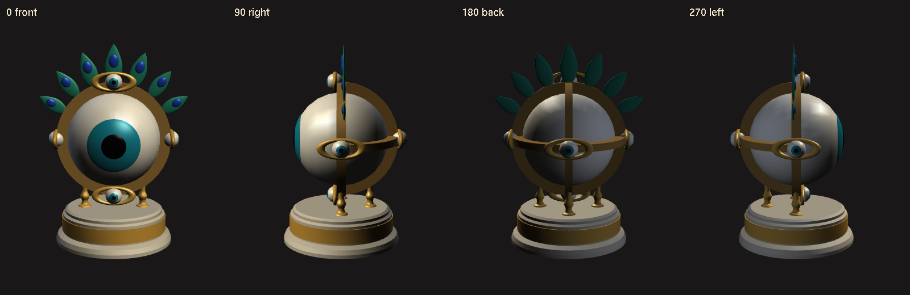

# 아르고스의 눈 설계서

| 항목 | 내용 |
|---|---|
| 담당 | 아르고스의 눈 담당 |
| 브랜치 | `feature/argos-eye` |
| 게임 속 역할 | 수집 아이템 / 미노타우르스에게 전달 → 능력: (4번 참고 — 확정 전) |
| 레퍼런스 | 담당자가 준비한 45° 간격 8방향 콘셉트 이미지 (저장소에 올리지 않음): 금테로 감싼 큰 눈알, 작은 눈 장식, 공작 깃털 왕관, 그리스 문양 석재 받침대 |
| 미리보기 |  — 아래 프로파일·조립 표대로 렌더링 (정면·우측·후면·좌측) |

---

## 1. 디자인

- 시대 분위기: 고대 그리스 신전의 감시 유물
- 형태: 석재 제단 위에 다리 3개가 금속 혼천의(테 + 뒤쪽 십자 띠)를 받치고, 그 안에 큰 눈알이 정면(+Z)을 본다. 테 위·아래·좌·우·뒤에 작은 눈 5개, 머리 위에 공작 깃털 7개
- 재질·색 (RGB 대략값)

| 재질 | 색 | 쓰는 부품 |
|---|---|---|
| 석재 아이보리 | (0.78, 0.74, 0.66), 광택 낮음 | 받침대 |
| 금 | (0.80, 0.60, 0.24), 광택 | 금띠, 다리, 작은 눈 금테 |
| 청동 | (0.62, 0.46, 0.22) | 원형 테, 뒤쪽 띠 |
| 흰자 | (0.93, 0.90, 0.84), 광택 높음 | 눈알 |
| 홍채 청록 | (0.08, 0.50, 0.58) | 홍채 |
| 동공 | (0.02, 0.02, 0.03) | 동공 |
| 깃털 청록 / 눈무늬 파랑 | (0.12, 0.50, 0.40) / (0.10, 0.25, 0.70) | 깃털 |

- 발광·특수 효과: 게임 코드 단계에서 정함 (예: 홍채 GL_EMISSION). 미궁 문양·핏줄은 나중에 텍스처로 넣을 수 있게 금띠·눈알을 따로 둠

## 2. SOR 부품 구성

좌표 규칙: 회전축 = **Y축**, 점은 **x = 반지름, y = 높이**, 위에서 아래로. 모두 `Models/argos_<부품>.prof` → 모델러에서 `.dat` 저장.

> **각진 모서리 = 같은 점 두 번:** base, band, ring, strap은 모서리 점을 두 번 넣었다. 넓이 0 삼각형이 생겨 법선이 양쪽 면으로 나뉘므로 모서리가 뭉개지지 않고 각진다. 모델러에서 고칠 때는 겹친 두 점을 함께 옮긴다.

| 부품 | 모양 | 분할 | 곡선 | 프로파일 점 (x, y) |
|---|---|---|---|---|
| `argos_base` | 계단형 석재 제단, 바닥 반지름 0.34, 높이 0.20 | 48 | ✗ | (0,.20) (.27,.20) (.285,.19) (.285,.175) (.30,.165) (.30,.06) (.33,.045) (.34,.02) (.34,0) (0,0) — 가운데 점 두 번씩 |
| `argos_band` | 받침대 둘레 금띠 (미궁 문양 자리). 안쪽 0.296은 받침대(0.30) 속에 묻힘 | 48 | ✗ | (.296,.15) (.306,.15) (.306,.07) (.296,.07) |
| `argos_leg` | 화병 모양 다리, y 0.195~0.34 | 12 | ✓ | (0,.34) (.02,.34) (.017,.32) (.016,.29) (.027,.26) (.018,.235) (.022,.215) (.036,.205) (.036,.195) (0,.195) |
| `argos_eyeball` | 구, 반지름 0.27, 중심 (0, 0.27) | 36 | ✗ | φ = 0°~180°를 15°마다: (0.27 sinφ, 0.27 + 0.27 cosφ) — 13점 |
| `argos_iris` | 구면 캡, 반지름 0.273, φ 0°~32° | 36 | ✗ | 4°마다 9점 + 가장자리를 반지름 0.27(구 표면)까지 닫는 1점 |
| `argos_pupil` | 구면 캡, 반지름 0.276, φ 0°~14° | 36 | ✗ | 3.5°마다 5점 + 가장자리를 0.273(홍채)까지 닫는 1점 |
| `argos_ring` | 사각 단면 링: 안 0.262, 바깥 0.33, 두께 ±0.025 | 48 | ✗ | (.262,0) (.262,.025) (.33,.025) (.33,−.025) (.262,−.025) (.262,0) — 시계 방향 닫힌 고리 |
| `argos_strap` | 같은 단면의 **반 바퀴(SWEEP 180)** 띠: 안 0.265, 바깥 0.325, 두께 ±0.02 | 24 | ✗ | (.265,0) (.265,.02) (.325,.02) (.325,−.02) (.265,−.02) (.265,0) |
| `argos_lid` | 작은 눈 금테: 둥근 단면 링 (중심 반지름 0.06, 굵기 0.012) | 24 | ✗ | 30°마다 12점 원 (시계 방향) |
| `argos_feather` | 방추형 깃털, 높이 0.26 | 16 | ✓ | (0,.26) (.03,.21) (.055,.13) (.045,.055) (.01,.005) (0,0) |

- 닫힌 고리 프로파일(ring, strap, lid)은 **시계 방향**(안쪽 → 위 → 바깥 → 아래)으로 찍는다. 그래야 바깥 면이 위에서 아래로 내려가 법선이 바깥을 향한다 (`hermes_ring`과 같은 방식).
- 홍채·동공 캡은 구보다 0.003씩 크고 같은 축(극점 = 정면)을 공유한다. 그래서 위도선이 일치해 구 표면에 자연스럽게 붙는다. 가장자리 1점이 아래 층까지 내려가 틈을 막는다.

## 3. 조립 (부품 배치)

변환은 **오른쪽부터 적용**한다 (OpenGL `glTranslate → glRotate → glScale` 호출 순서와 같음). `E` = 큰 눈 변환 = `T(0, 0.60, 0) · Rx(90°) · T(0, −0.27, 0)`
(구 중심을 원점으로 → X축 +90°로 극점(+Y)을 정면(+Z)으로 → 눈 중심 높이 0.60으로)

| 부품 (개수) | 변환 | 색 |
|---|---|---|
| base, band | 그대로 | 석재 / 금 |
| leg ×3 | `T(±0.17, 0, 0)`, `T(0, 0, −0.17)` — 위끝이 정면 테·세로 띠 속으로 들어감 | 금 |
| eyeball, iris, pupil | `E` (셋 다 같은 변환 → 눈 회전·홍채 색은 이 묶음만 바꾸면 됨) | 흰자 / 청록 / 검정 |
| ring (정면 테) | `T(0, 0.60, 0) · Rx(90°)` — XY 평면에 세움. 안쪽 0.262 < 눈알 0.27이라 눈알을 붙잡음 | 청동 |
| strap (가로 띠) | `T(0, 0.60, 0)` — +x → 뒤(−z) → −x 반 바퀴, 양 끝이 정면 테에 묻힘 | 청동 |
| strap (세로 띠) | `T(0, 0.60, 0) · Rz(90°) · S(1.01)` — 위 → 뒤 → 아래. 1% 키워 가로 띠와 면이 겹쳐 깜빡이지 않게 | 청동 |
| 작은 눈 ×5 | 위치 c와 방향 yaw: 위 (0, .93, .035) 0°, 아래 (0, .27, .035) 0°, 오른쪽 (.33, .60, 0) 90°, 왼쪽 (−.33, .60, 0) −90°, 뒤 (0, .60, −.335) 180° | |
| └ 눈알·홍채·동공 | `T(c) · Ry(yaw) · Rx(90°) · S(0.18) · T(0, −0.27, 0)` — 큰 눈 메시 재사용 | 흰자 / 청록 / 검정 |
| └ 금테 (lid) | `T(c) · Ry(yaw) · S(1.8, 0.8, 1) · Rx(90°)` — 비균등 스케일로 원 → 아몬드 모양 | 금 |
| feather ×7 | k = −3…3, a = 20°·k, s = 0.9 − 0.2·\|k\|/3: `F = T(0, 0.60, −0.015) · Rz(a) · T(0, 0.31, 0) · S(s)`, 깃털 = `F · S(1, 1, 0.2)` — 뿌리가 정면 테 속(반지름 0.31)에 꽂힘 | 깃털 청록 |
| └ 눈무늬 | `F · T(0, 0.15, 0.006) · S(0.12, 0.16, 0.05) · Rx(90°) · T(0, −0.27, 0)` — 눈알 메시를 작게 납작하게 재사용 | 파랑 |

- 전체 크기: x ±0.43, y 0 ~ 1.14, z −0.39 ~ 0.34 (게임에서 scale로 조절)
- **비균등 스케일 주의:** 깃털·금테는 비균등 스케일이라 법선 길이가 바뀐다 → 그릴 때 `glEnable(GL_NORMALIZE)`.
- 검증: 저장소 밖 임시 프로그램이 공용 `BuildSOR`로 같은 메시를 만들어 조립하고, 부품 간 거리를 쟀다. 정점이 다른 부품 면 안쪽에 있으면 겹침, 최소 거리가 0.003보다 크면 뜸으로 판정했다. 떠 있는 부품은 없다. 겹침은 위 표의 의도한 맞물림(다리↔테, 눈알↔테, 작은 눈↔테·띠, 깃털 뿌리↔테, 띠 교차부)뿐이다.

## 4. 게임 능력 사양

> ⚠️ **확정 전.** 팀 표(CONTRIBUTING.md)에는 "텔레파시 (실타래 발광)"로 되어 있고, 담당자는 "감시 장치"(좌우로 둘러보는 눈, 플레이어가 들어오면 홍채 색 변경)도 구상했다. 미로 기반이 main에 들어온 뒤 팀과 정한다.

| 항목 | 내용 |
|---|---|
| 능력 | (미정) |
| 발동 조건 | 미노타우르스에게 아이템 전달 후 해금 |
| 입력 키 | Q (키 배정표 제안값) |
| 지속 시간 / 쿨타임 | (미정) |
| 수치 | (미정) |
| 다른 기능과의 연동 | 아리아드네의 실타래 발광 (팀 표 기준) |
| 화면 표시 | (미정) |

모델 구조상 준비된 점: 큰 눈(eyeball·iris·pupil)이 변환 `E` 하나로 묶여 있다. 그래서 받침대와 따로 회전할 수 있고, 홍채 색은 iris 재질만 바꾸면 된다. 메시는 한 번 불러 두고 변환만 바꿔 여러 개 배치할 수 있다.

## 5. 사용하는 그래픽스 기법 (시연·보고서용)

- SOR: Y축 회전 행렬로 프로파일 회전 → 정점 `i·P + j`, 사각형마다 삼각형 2개 (CCW), 넓이 가중 정점 법선
- 부분 회전 (SWEEP 180°): 뒤쪽 반 바퀴 띠
- 같은 점 두 번 → 넓이 0 삼각형으로 각진 모서리 법선
- 구면 캡을 같은 축으로 겹쳐 홍채·동공 표현 (구 표면과 위도선 일치)
- 메시 재사용 + 비균등 스케일(아몬드 금테, 납작한 깃털), `GL_NORMALIZE`
- 계층 변환: 눈 묶음 `E`, 깃털 `F`를 공유하는 하위 부품
- 조명·재질: `GL_DIFFUSE / GL_SPECULAR / GL_SHININESS` (금속·흰자 광택), Smooth Shading

## 6. 확인 방법

- [x] 프로파일 10개 작성 (`Models/argos_*.prof`)
- [x] 임시 프로그램으로 조립, 네 방향 확인, 겹침·뜸 수치 검사
- [x] 모델러에서 `.prof`를 열어 `.dat` 저장 (담당자)
- [x] 저장된 `.dat` 검사: 10개 모두 `.prof`로 다시 만든 메시와 정점·법선 차이 1e-6 이하, 삼각형 index 완전 일치, 법선 단위 길이, 면 방향(CCW) 정상
- [ ] 게임에서 `.dat` 불러와 배치 (미로 기반 이후)
- [ ] 능력 동작 확인 (능력 확정 후)
