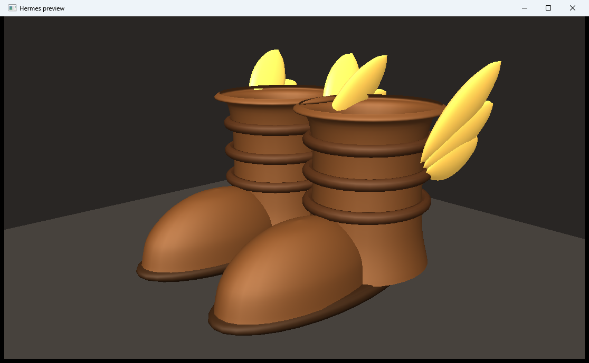

# 헤르메스의 신발 설계서

| 항목 | 내용 |
|---|---|
| 담당 | 헤르메스의 신발 담당 |
| 게임 속 역할 | 수집 아이템 → 미노타우르스에게 전달 → 능력: **대쉬** |
| 레퍼런스 | 고대 그리스풍 가죽끈 샌들 + 뒤꿈치의 큰 깃털 날개 |
| 미리보기 |  — 아래 프로파일·조립 표대로 렌더링 (네 방향) |

> 첫 안(날개 달린 하이탑 부츠)은 앞코가 공처럼 둥글기만 해서 샌들로 다시 설계했다.

---

## 1. 디자인

- 시대 분위기: 고대 그리스 — 벽돌 미로, 등불
- 형태: 앞이 열린 **가죽끈 샌들 한 켤레**, 바깥쪽 뒤꿈치에 층이 있는 **큰 날개**
- 재질·색

| 부위 | 재질 | RGB (대략) |
|---|---|---|
| 밑창 안쪽, 발등 띠, 뒤꿈치, 발목 밴드 | 가죽 | (0.48, 0.29, 0.15) |
| 밑창 바깥, 발목 끈, 납작 끈 | 진한 가죽 | (0.26, 0.15, 0.08) |
| 긴 깃털 | 흰빛 (약한 발광) | (0.86, 0.82, 0.70) |
| 덮깃, 소용돌이, 단추, 금색 테 | 금빛 (약한 발광) | (0.80, 0.60, 0.22) |

- 아이템 상태 효과 (나중): 흰·금빛 후광, 밝기 맥동, 천천히 회전·부유, 작은 점광원

## 2. SOR 부품 (9종)

회전축 = **Y축**, x = 반지름(≥ 0), y = 높이. 닫힌 단면(발등 띠·고리 띠·뒤꿈치·발목 밴드·고리)은
**안쪽 → 위 → 바깥쪽 → 아래 → 안쪽** 순서로 돌아야 법선이 바깥을 향한다.
회전 범위가 180°인 부품은 +x에서 시작해 −z 쪽으로 돌아 −x에서 끝난다.

### 밑창 `hermes_footbed`
- 회전축을 **발 길이 방향으로 눕혀** 쓴다. x = 발의 반폭, y = 길이(위 = 발끝, 아래 = 뒤꿈치). 조립 때 납작하게 누른다
- 분할 수 20, 회전 범위 360°, 곡선 사용

| # | x | y |
|---|---|---|
| 0 | 0.000 | 1.000 |
| 1 | 0.073 | 0.985 |
| 2 | 0.133 | 0.933 |
| 3 | 0.180 | 0.825 |
| 4 | 0.190 | 0.720 |
| 5 | 0.165 | 0.550 |
| 6 | 0.140 | 0.400 |
| 7 | 0.133 | 0.280 |
| 8 | 0.137 | 0.150 |
| 9 | 0.110 | 0.060 |
| 10 | 0.060 | 0.015 |
| 11 | 0.000 | 0.000 |

### 발등 띠 `hermes_arch`
- 닫힌 띠 단면을 **180°만** 회전한 반원 띠
- 분할 수 20, 회전 범위 180°, 곡선 사용 안 함

| # | x | y |
|---|---|---|
| 0 | 0.460 | 0.000 |
| 1 | 0.460 | 0.050 |
| 2 | 0.470 | 0.060 |
| 3 | 0.490 | 0.060 |
| 4 | 0.500 | 0.050 |
| 5 | 0.500 | 0.000 |
| 6 | 0.500 | −0.050 |
| 7 | 0.490 | −0.060 |
| 8 | 0.470 | −0.060 |
| 9 | 0.460 | −0.050 |
| 10 | 0.460 | 0.000 |

### 고리 띠 `hermes_band`
- 발등 띠와 같은 단면을 360° 회전 (발목 끈, 금색 테)
- 분할 수 28, 회전 범위 360°, 곡선 사용 안 함

| # | x | y |
|---|---|---|
| 0 | 0.460 | 0.000 |
| 1 | 0.460 | 0.050 |
| 2 | 0.470 | 0.060 |
| 3 | 0.490 | 0.060 |
| 4 | 0.500 | 0.050 |
| 5 | 0.500 | 0.000 |
| 6 | 0.500 | −0.050 |
| 7 | 0.490 | −0.060 |
| 8 | 0.470 | −0.060 |
| 9 | 0.460 | −0.050 |
| 10 | 0.460 | 0.000 |

### 뒤꿈치 감싸개 `hermes_heel`
- 닫힌 벽 단면을 **180°만** 회전한 반원 컵
- 분할 수 20, 회전 범위 180°, 곡선 사용 안 함

| # | x | y |
|---|---|---|
| 0 | 0.450 | 0.300 |
| 1 | 0.450 | 0.582 |
| 2 | 0.465 | 0.600 |
| 3 | 0.500 | 0.600 |
| 4 | 0.515 | 0.576 |
| 5 | 0.490 | 0.360 |
| 6 | 0.500 | 0.150 |
| 7 | 0.475 | 0.000 |
| 8 | 0.450 | 0.000 |
| 9 | 0.450 | 0.300 |

### 발목 밴드 `hermes_cuff`
- 위아래 테와 주름이 있는 넓은 띠
- 분할 수 32, 회전 범위 360°, 곡선 사용 안 함

| # | x | y |
|---|---|---|
| 0 | 0.465 | 0.250 |
| 1 | 0.465 | 0.490 |
| 2 | 0.485 | 0.500 |
| 3 | 0.530 | 0.500 |
| 4 | 0.535 | 0.465 |
| 5 | 0.500 | 0.440 |
| 6 | 0.510 | 0.375 |
| 7 | 0.500 | 0.310 |
| 8 | 0.510 | 0.250 |
| 9 | 0.500 | 0.190 |
| 10 | 0.510 | 0.125 |
| 11 | 0.500 | 0.060 |
| 12 | 0.530 | 0.035 |
| 13 | 0.525 | 0.000 |
| 14 | 0.485 | 0.000 |
| 15 | 0.465 | 0.015 |
| 16 | 0.465 | 0.250 |

### 납작 끈 `hermes_tongue`
- 양 끝이 둥근 막대. 조립 때 납작하게 눌러 두 점을 잇는 끈으로 쓴다
- 분할 수 10, 회전 범위 360°, 곡선 사용 안 함

| # | x | y |
|---|---|---|
| 0 | 0.000 | 1.000 |
| 1 | 0.050 | 0.988 |
| 2 | 0.080 | 0.960 |
| 3 | 0.095 | 0.920 |
| 4 | 0.100 | 0.870 |
| 5 | 0.100 | 0.500 |
| 6 | 0.100 | 0.130 |
| 7 | 0.095 | 0.080 |
| 8 | 0.080 | 0.040 |
| 9 | 0.050 | 0.012 |
| 10 | 0.000 | 0.000 |

### 깃털 `hermes_plume`
- 잎 모양. 조립 때 납작하게 눌러 길이·각도를 바꿔 여러 번 쓴다
- 분할 수 10, 회전 범위 360°, 곡선 사용 안 함

| # | x | y |
|---|---|---|
| 0 | 0.000 | 1.000 |
| 1 | 0.022 | 0.979 |
| 2 | 0.041 | 0.943 |
| 3 | 0.058 | 0.869 |
| 4 | 0.075 | 0.767 |
| 5 | 0.084 | 0.645 |
| 6 | 0.092 | 0.513 |
| 7 | 0.085 | 0.360 |
| 8 | 0.074 | 0.240 |
| 9 | 0.056 | 0.130 |
| 10 | 0.030 | 0.040 |
| 11 | 0.000 | 0.000 |

### 고리 `hermes_ring`
- 토러스. 날개 밑 소용돌이 장식
- 분할 수 24, 회전 범위 360°, 곡선 사용 안 함

| # | x | y |
|---|---|---|
| 0 | 0.312 | 0.000 |
| 1 | 0.324 | 0.044 |
| 2 | 0.356 | 0.076 |
| 3 | 0.400 | 0.088 |
| 4 | 0.444 | 0.076 |
| 5 | 0.476 | 0.044 |
| 6 | 0.488 | 0.000 |
| 7 | 0.476 | −0.044 |
| 8 | 0.444 | −0.076 |
| 9 | 0.400 | −0.088 |
| 10 | 0.356 | −0.076 |
| 11 | 0.324 | −0.044 |
| 12 | 0.312 | 0.000 |

### 단추 `hermes_stud`
- 구
- 분할 수 14, 회전 범위 360°, 곡선 사용 안 함

| # | x | y |
|---|---|---|
| 0 | 0.000 | 0.120 |
| 1 | 0.046 | 0.111 |
| 2 | 0.085 | 0.085 |
| 3 | 0.111 | 0.046 |
| 4 | 0.120 | 0.000 |
| 5 | 0.111 | −0.046 |
| 6 | 0.085 | −0.085 |
| 7 | 0.046 | −0.111 |
| 8 | 0.000 | −0.120 |

## 3. 조립 (오른발 기준)

신발 좌표: 바닥 y = 0, 앞쪽 = +z, 바깥쪽 = +x. 코드 호출 순서: **이동 → 회전 → 크기**.

### 3-1. 바탕

| 부품 | 위치 | 회전 | 크기 | 색 |
|---|---|---|---|---|
| 밑창(바깥) footbed | (0, 0.026, −0.50) | X 90° | (1.00, 1.00, 0.14) | 진한 가죽 |
| 밑창(안쪽) footbed | (0, 0.040, −0.48) | X 90° | (0.92, 0.96, 0.11) | 가죽 |
| 뒤꿈치 heel | (0, 0.035, −0.335) | — | (0.260, 0.425, 0.300) | 가죽 |
| 발목 밴드 cuff | (0, 0.470, −0.295) | — | (0.276, 0.250, 0.316) | 가죽 |
| 금색 테 band ×2 | (0, 0.590 / 0.474, −0.295) | — | (0.300, 0.117, 0.342) | 금 |
| 발목 끈 band | (0, 0.305, −0.312) | — | (0.276, 0.417, 0.356) | 진한 가죽 |
| 발목 끈 band | (0, 0.395, −0.302) | — | (0.268, 0.283, 0.336) | 진한 가죽 |

### 3-2. 발등 띠 arch — 위치 (0, 0.045, z), 회전 X 기울기 → X 90°, 색 가죽

| z | 기울기 | 크기 |
|---|---|---|
| 0.310 | −4° | (0.330, 0.417, 0.190) |
| 0.185 | −7° | (0.352, 0.483, 0.280) |
| 0.050 | −10° | (0.316, 0.483, 0.400) |
| −0.070 | −13° | (0.272, 0.483, 0.550) |

### 3-3. 납작 끈 tongue — 시작점에 놓고 Y축을 끝점 쪽으로 돌린 뒤 크기 (폭, 길이, 두께), 색 진한 가죽

| 시작점 | 끝점 | 폭, 두께 |
|---|---|---|
| (0, 0.112, 0.375) | (0, 0.189, 0.165) | 0.34, 0.09 |
| (0, 0.184, 0.180) | (0, 0.252, 0.012) | 0.34, 0.09 |
| (0, 0.244, 0.030) | (0, 0.327, −0.130) | 0.34, 0.09 |
| (0, 0.310, −0.128) | (0, 0.500, −0.130) | 0.34, 0.09 |
| (0, 0.240, −0.482) | (0, 0.510, −0.458) | 0.34, 0.07 |
| (±0.133, 0.250, −0.300) | (±0.140, 0.510, −0.295) | 0.07, 0.30 |
| (±0.135, 0.310, −0.330) | (±0.150, 0.050, −0.050) | 0.07, 0.26 |

회전: 방향 (dx, dy, dz), 길이 L일 때 `glRotatef(acos(dy / L), dz, 0, −dx)`

### 3-4. 단추 stud — 크기 s / 0.12, 색 금

(0, 0.146, 0.300) (0, 0.193, 0.160) (0, 0.258, 0.006) s = 0.015 · (0, 0.334, −0.120) s = 0.017 ·
(0, 0.535, −0.124) s = 0.019 · (±0.140, 0.308, −0.318) s = 0.014

### 3-5. 날개 — 전체에 이동 (0.136, 0.200, −0.385) → Z −17° → Y −12°

깃털 뿌리: t = i / (개수 − 1), Y(t) = 0.02 + 0.36·t^0.9, Z(t) = −0.01 − 0.12·t^1.6. 회전은 X −φ. 크기 (두께, 길이, 폭).

| 깃털 plume | 개수 | 위치 (x, y, z) | φ | 길이 | 폭 | 두께 |
|---|---|---|---|---|---|---|
| 긴 깃털 (흰빛) | 10 | (−0.006 + 0.0014·i, Y, Z) | 114 − 88t | 0.17 + 0.28t | 0.52 + 0.12t | 0.10 |
| 덮깃 (금, 안팎 양면) | 10 × 2 | ±(0.014 + 0.001·i), Y − 0.005, Z | 106 − 82t | 0.09 + 0.12t | 0.38 | 0.10 |
| 잔깃 (금, 안팎 양면) | 8 × 2 | ±0.024, Y − 0.012, Z + 0.004 | 88 − 64t | 0.055 + 0.045t | 0.27 | 0.10 |

소용돌이(금): ring 위치 (0.024, −0.005, 0) 크기 0.056 / 0.4, (0.030, −0.005, 0) 크기 0.034 / 0.4 (둘 다 Z 90°),
stud 위치 (0.030, −0.005, 0) 크기 0.020 / 0.12

### 3-6. 한 켤레

- **오른발:** x = +0.28 이동. **왼발:** x = −0.28 이동 뒤 sx = −1 (좌우 반전)
- 음수 scale은 삼각형 감김 방향이 뒤집히므로 왼발은 `glFrontFace(GL_CW)`로 그린다
- 한 켤레 삼각형 약 51,000개 → 게임에서는 디스플레이 리스트 등으로 묶어 그리기

## 4. 게임 능력 사양: 대쉬

| 항목 | 내용 |
|---|---|
| 능력 | 기본 이동속도 증가 + 바라보는 방향으로 순간적으로 빠르게 이동 (가시 구덩이를 넘는다) |
| 발동 조건 | 신발을 미노타우르스에게 전달한 뒤 해금 |
| 입력 키 | **Shift** (CONTRIBUTING.md 키 배정표) |
| 지속 시간 / 쿨타임 | 0.3초 / 1.5초 |
| 수치 | 기본 이동속도 ×1.25 (3.4 → 4.25). 대쉬 속도 = 기본 속도 ×4 → 약 5.1 이동 (가시 구덩이 한 칸 2.0 + 여유) |
| 다른 기능과의 연동 | **가시 구덩이(`^`):** 대쉬 중에만 `maze.pitsPassable`이 켜져 지나갈 수 있다. 구덩이 위에서 끝나면 마지막 안전한 위치로 되돌아간다. **충돌 처리:** 빠르게 움직이면 한 프레임에 벽을 통과(터널링)할 수 있으므로, 이동을 여러 번의 작은 단계로 나눠(sub-step) 단계마다 충돌 검사 |
| 화면 표시 | 오른쪽 아래 쿨타임 게이지, 대쉬 중 시야각(FOV) +12° (금빛 잔상은 추가 예정) |
| 코드 | `MazeGame/HermesShoes.cpp` |

## 5. 사용하는 그래픽스 기법 (시연·보고서용)

- **SOR:** Y축 회전 행렬 `x' = x·cosθ + z·sinθ, z' = −x·sinθ + z·cosθ`, 회전 각도 = 회전 범위 / 분할 수
- **부분 회전:** 180°만 돌리면 반원 띠·반원 컵이 된다. 끝이 이어지지 않으므로 정점 줄이 하나 더 필요하다
- **Mesh:** 정점 index `i·P + j`, 사각형 → 삼각형 2개(반시계), 외적으로 법선
- **곡선:** Catmull-Rom 스플라인 (밑창)
- **토러스:** 축에서 떨어진 원 프로파일
- **모델 변환:** 회전축 눕히기, non-uniform scale, 음수 scale 좌우 반전, 같은 부품을 여러 번 배치
- **조명·재질:** 가죽(낮은 광택) vs 금(`GL_SPECULAR` 높게 + `GL_EMISSION`)

## 6. 확인 방법

- [ ] 모델러에서 부품 9개를 열어 고치고 `Models/hermes_*.dat` 저장
- [ ] 게임에서 `.dat`을 불러와 3번 표대로 조립·배치
- [ ] 아이템 효과(발광·회전·부유) 확인
- [ ] 전달 후 Shift 대쉬, 벽 통과 없음, 쿨타임 동작 확인
